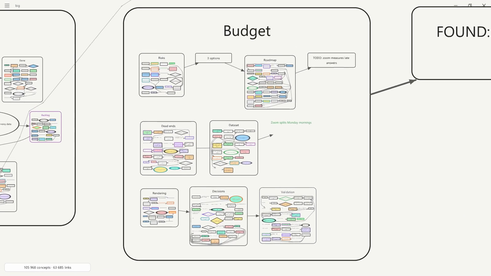
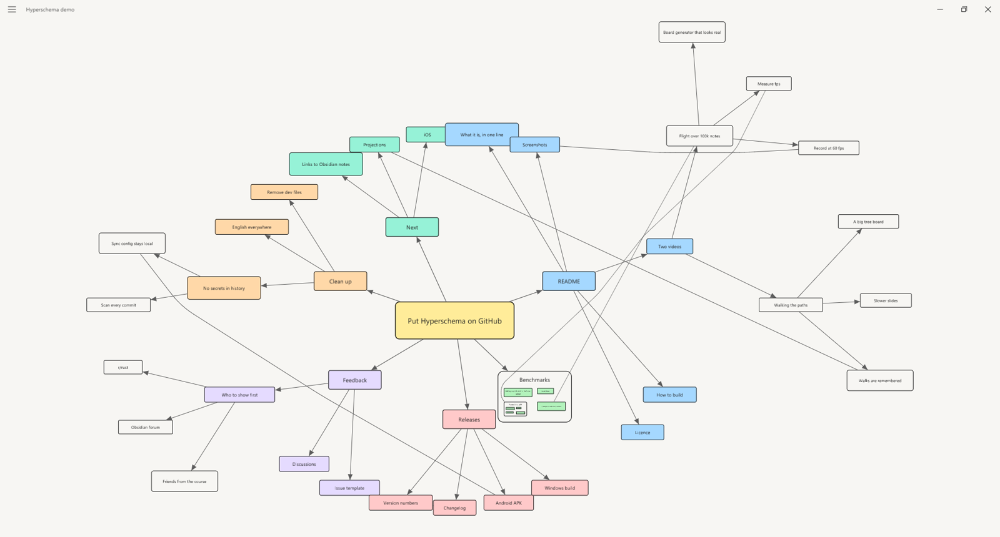
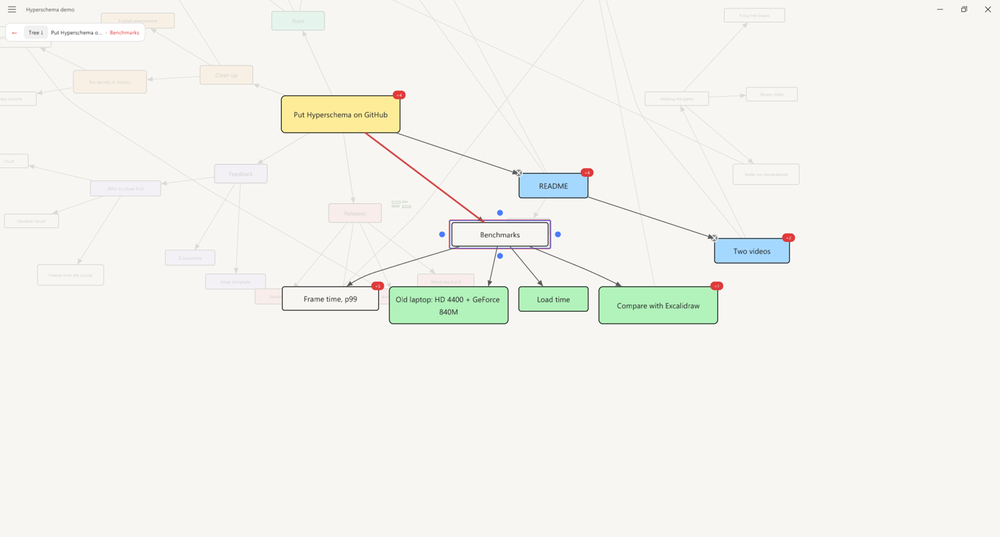
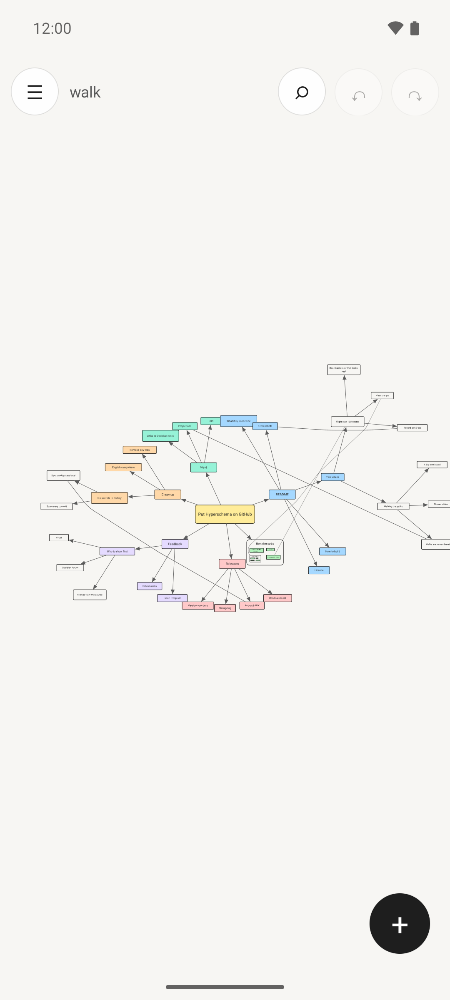

# Hyperschema

An infinite board for thinking: notes, frames inside frames, arrows between
them — and it stays smooth when the board gets huge.



<!-- VIDEO: flight over 106 000 concepts -->

I keep everything I think about on one board: projects, plans, research,
a diary. On Excalidraw that board started to stutter at about 500
elements. Hyperschema is the replacement: a Rust core that draws on the GPU,
thin native shells for Windows and Android, and a board format where nesting
and links are first-class.

## What it does

- **Huge boards stay smooth.** The flight video flies over 106 000 concepts
  and 64 000 links on a 2014 laptop. Each level of nesting is several times
  smaller than the one holding it, so the camera goes from the whole board
  down to a single note across six orders of magnitude.
- **Frames inside frames.** A concept can hold other concepts; moving or
  scaling it carries them along. Text stays readable as far out as it can,
  then turns into soft bars instead of vanishing.
- **Path mode: walk the board along its links.** Select a note and press
  *Path*: what it links to slides out next to it, everything else dims. Step
  from note to note; what you looked at stays out, whichever way you go.
  Step into a frame and what it holds comes out at one scale. Esc slides
  everything home. Walks are remembered: open the same note again and the
  same walk comes back.
- **Sync between devices.** Boards merge edits from a laptop, a phone and
  scripts within a second or two (Automerge documents over CouchDB).
- **A command line for agents.** `hyperschema add / link / move / show …`
  edits boards from scripts and AI agents, with the same sync.
- **Excalidraw import**, including Obsidian `.excalidraw.md` files.
- **Mouse, touchpad and touch** from the start.
- **Windows and Android**, one Rust core under both. English, or Russian
  when the system is in Russian.

<!-- VIDEO: path mode -->

## Screenshots

| Windows: a board | Windows: path mode |
|---|---|
|  |  |

<p align="center"></p>

## Sync

Sync is optional: without it every board lives on its device. With it, all
devices share one CouchDB database. Each board is an Automerge document;
devices only ever add batches of changes (`chg:` documents) and never
rewrite each other's, so the database never conflicts and merging is
Automerge's job. Edits from another device show up within a second or two.

1. Run CouchDB 3 somewhere all your devices can reach (behind HTTPS) and
   create a database (`hyperschema` by default) and a user that can write
   to it.
2. Give each device the connection, a small JSON:

   ```json
   {"url": "https://couch.example.com", "db": "hyperschema", "user": "…", "password": "…"}
   ```

   On every device: menu → *Sync server…*. On Windows, copy the text and
   choose *Paste connection from clipboard*; on Android, paste it there.

The connection stays on the device; nothing about the server is built into
the app. The command line (`hyperschema help`) uses the same connection, so
scripts and AI agents edit the same boards and their edits sync too.

## Performance

Measured on a 2014 laptop: Intel HD 4400 + GeForce 840M, 60 Hz screen.
The board is generated to look like a hand-made one
(`cargo run --release -p hs-core --example gen_board -- 100000 big.hyperschema`).

| Board | Concepts | Links | Load | Average | p50 | p95 | p99 |
|---|---:|---:|---:|---:|---:|---:|---:|
| Generated, 6 levels | 106 000 | 64 000 | 13 s | 57 fps | 17.2 ms | 19.2 ms | 23.6 ms |

The same 14-second flight as in the video, in real time. About 3% of frames
take longer than 20 ms, the worst one 0.3 s: text being laid out again when
the camera crosses a zoom level; that is the next thing to move off the
frame.

The videos in this README are rendered frame by frame
(`--record out.mp4`: the app runs on a virtual clock and pipes each frame to
ffmpeg), so they are smooth regardless of the machine. The numbers above are
the real-time ones.

Reproduce: `hyperschema big.hyperschema --tour --hud` flies the camera over
the board, then writes `bench-result.txt` and a per-frame `bench-frames.csv`.
Add `--record flight.mp4` to render the same flight as a video (needs
`ffmpeg` on `PATH`).

## Build

Requirements: Rust (stable). Android: Android SDK, NDK 28, JDK 17.

```bash
cargo build --profile dist -p hyperschema
```

The Windows build is `target/dist/hyperschema.exe`. Android:
`bash tools/build-android.sh` (APK in `shell-android/app/build/outputs/apk/release/`).

## Project

- `core/` — everything shared: board model, editor, touch gestures, path
  mode, routing of links, sync, and the wgpu renderer (Morton quadtree,
  glyph atlas, camera in double precision).
- `desktop/` — Windows shell (winit, own title strip, DirectManipulation
  touchpad), command line for agents, scripted input for tests and demos.
- `android/`, `shell-android/` — Android shell (Kotlin) over the same core.
- `docs/demo/` — the board and script behind the path-mode video.


## License

[GPL-3.0](LICENSE). Text is drawn with the system font (Segoe UI on Windows,
Roboto or Noto Sans on Android); no fonts are bundled.
